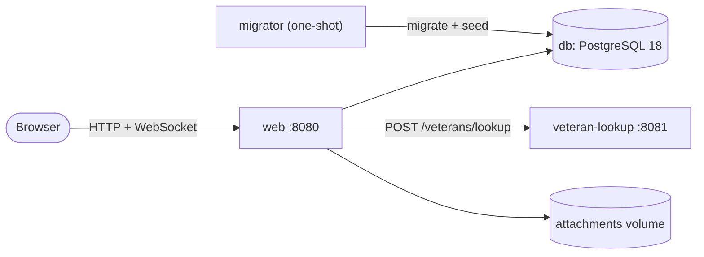

# Architecture overview

One page for the live walkthrough. The full detail is in [architecture.md](architecture.md), the decisions in the
[ADRs](adr/README.md), and the exact versions in [versions.md](versions.md).

## 1. What runs

**.NET 10 LTS · Blazor Web App (Interactive Server) · EF Core 10 · PostgreSQL 18 · Linux containers (Docker Compose)**

**Start order is enforced:** `db` healthy → `migrator` applies the schema, seeds 72 synthetic cases and exits 0 →
`veteran-lookup` healthy → `web` starts. Only `web` is published to the host. Browser tests run against `web-e2e`, the
same production image, with its own database (`caseintake_e2e`) and volumes, so they never touch the demo data. Every
image and package is pinned.

## 2. How the code is organised

A **modular monolith**: one deployable, with feature modules that **never reference each other**. An architecture
test fails the build if one does.

| Module | Owns |
|---|---|
| `Domain` | The case, the workflow table, validation rules. Pure C#, no database |
| `Cases` | Intake, list, detail, edit, status changes, assignment, audit trail |
| `Identity` | Sign-in, permission policies, user and role administration, audit log and error log services, System Health, security headers |
| `Attachments` | Upload checks, protected storage, download |
| `VeteranLookup.Client` | The resilient HTTP client for the lookup service |
| `TestResults` | Imports test runs and their evidence into the app |

## 3. Who can do what (roles and permissions in the database)

Since Change 1 ([ADR 0013](adr/0013-database-roles-and-permissions.md)) roles and their permissions are stored in the
database, and every page, service and button checks a **permission**, never a role name. `RolePermissionMap` in code is
the **default** each built-in role is seeded with once; administrators change it on the Roles page and the seed never
overwrites those changes. Per-user Allow and Deny overrides apply on top, and Deny always wins (C1-3). The defaults:

| Permission | Auditor | IntakeClerk | CaseWorker | Supervisor | QualityAnalyst | Administrator |
|---|:-:|:-:|:-:|:-:|:-:|:-:|
| View cases | ✓ | ✓ | ✓ | ✓ | ✓ | ✓ |
| Download attachments | ✓ | ✓ | ✓ | ✓ | | ✓ |
| Create cases, look up veterans, upload | | ✓ | ✓ | ✓ | | ✓ |
| Edit cases | | | ✓ | ✓ | | ✓ |
| Triaged → In Progress, In Progress → Resolved | | | ✓ | ✓ | | ✓ |
| New → Triaged, Resolved → Closed, Resolved → In Progress (reopen) | | | | ✓ | | ✓ |
| Assign cases, manage users | | | | ✓ | | ✓ |
| View the audit log | ✓ | | | ✓ | | ✓ |
| View and manage test results | | | | | ✓ | ✓ |
| Manage roles, view and manage errors, System Health | | | | | | ✓ |

The four case roles nest (Auditor ⊂ IntakeClerk ⊂ CaseWorker ⊂ Supervisor). QualityAnalyst is separate, and
Administrator always holds every permission. Administration never escalates: nobody grants a permission they do not
hold (C1-4).

## 4. Decisions, tradeoffs, assumptions and known limitations

| Decision | Alternative considered | Tradeoff | ADR |
|---|---|---|---|
| Interactive Server render mode | WebAssembly, Auto | A live connection and server memory per tab, in exchange for no public API to secure and authorization in one place | [0010](adr/0010-render-mode.md) |
| PostgreSQL 18 with `xmin` as the concurrency token | SQL Server, SQLite | Slightly more ceremony per operation, for correct concurrency | [0002](adr/0002-data-access-and-database.md) |
| Workflow as one domain-owned table | A state-machine library; a database-driven workflow | Changing the workflow is a code change plus tests; the 25-pair test catches any drift | [0005](adr/0005-case-workflow.md) |
| Permissions checked, not roles | `[Authorize(Roles = …)]` on each page | Every check names one permission; the permission names stay in code with one policy each | [0007](adr/0007-roles-and-permissions.md) |
| Roles and permissions in the database, seeded from the code defaults | Keep the compiled matrix; read roles from the database on every check | Permission and override changes apply at the next request; role membership changes apply at the next sign-in, which is forced within one minute | [0013](adr/0013-database-roles-and-permissions.md) |
| One append-only system audit log next to the existing case and test-result trails | Move every trail into one table | The viewer reads three sources; deep pages cost more and are capped at 10,000 entries | [0014](adr/0014-system-audit-log.md) |
| Error and Critical log events stored through a bounded queue, without exception messages | A database logger writing synchronously | Errors logged while the queue is full are lost from the store (still on stdout) | [0015](adr/0015-error-log-and-system-health.md) |
| NUnit 4.4 and Playwright 1.52 for every test suite (TRM, Q111) | Keep xUnit 2.9 and Playwright 1.63 | A shared `Assert` helper keeps each test's meaning; no Playwright APIs newer than 1.52 | [0016](adr/0016-nunit-and-playwright-pins.md) |
| The Government's §4.6 OpenAPI file is the lookup contract, served verbatim | A contract generated from our code | We never edit the contract; our extensions are listed separately | [0008](adr/0008-veteran-lookup-mock-and-client.md) |
| Attachments on a volume, metadata in PostgreSQL | Database blobs; S3-style object storage | A crash mid-upload can leave an unreferenced file, which is never served; the migrator removes it on a later start, once it is older than one hour (D9) | [0009](adr/0009-attachment-storage.md) |

**Key assumptions** (full log: [assumptions-and-limitations.md](assumptions-and-limitations.md)):
- **D1:** the §4.6 definition is the lookup contract. Our docs first said none was supplied; we corrected that,
  serve it verbatim and prove conformance with a test.
- **A5:** four nested case roles; since Change 1 their matrix is the seeded default, plus `Administrator` with every
  permission (C1-2). **E5-4** adds the separate QualityAnalyst role for test results.
- **A7:** a new case starts in New, and every transition not listed in §4.3 is rejected.

**Known limitations** (full list in [assumptions-and-limitations.md](assumptions-and-limitations.md)):
- No malware scanning; uploads are checked by type, leading bytes and size, and always served as downloads.
- No production identity provider and no HTTPS (the spec serves `http://localhost:8080`).
- Logs go to stdout, and Error and Critical events are also stored for the in-app error log (ADR 0015); there is no
  production monitoring, alerting or tracing backend.
