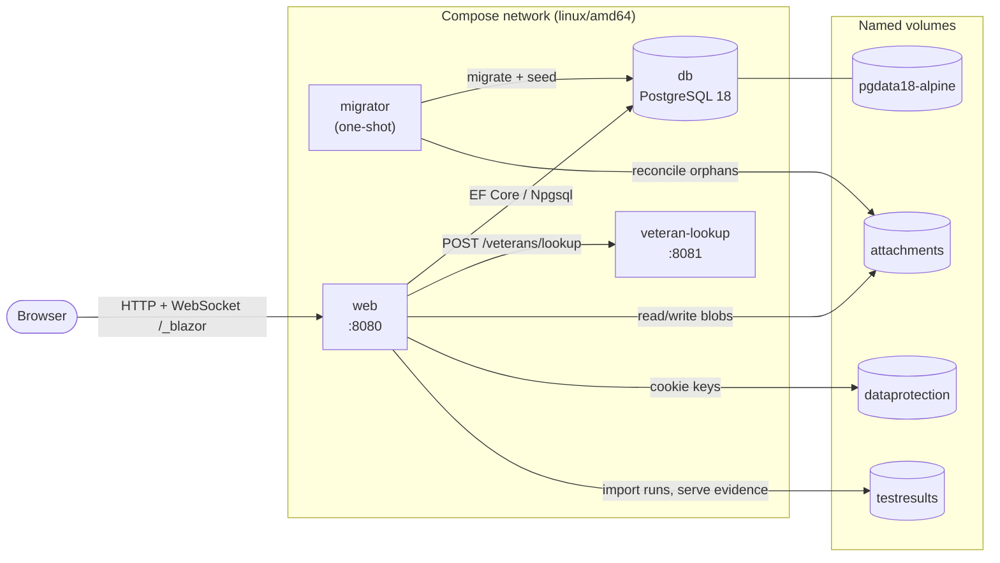
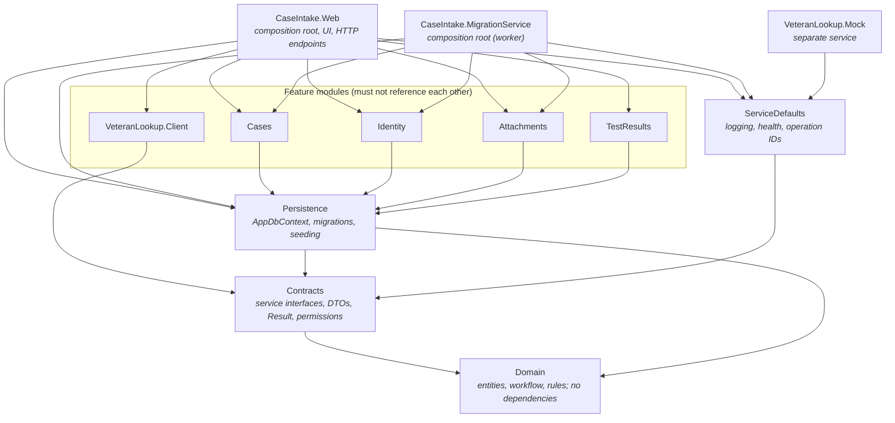
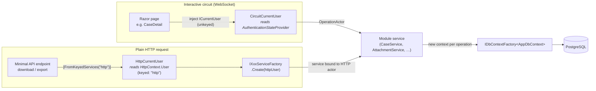
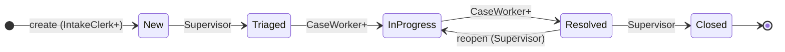
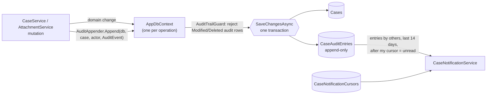
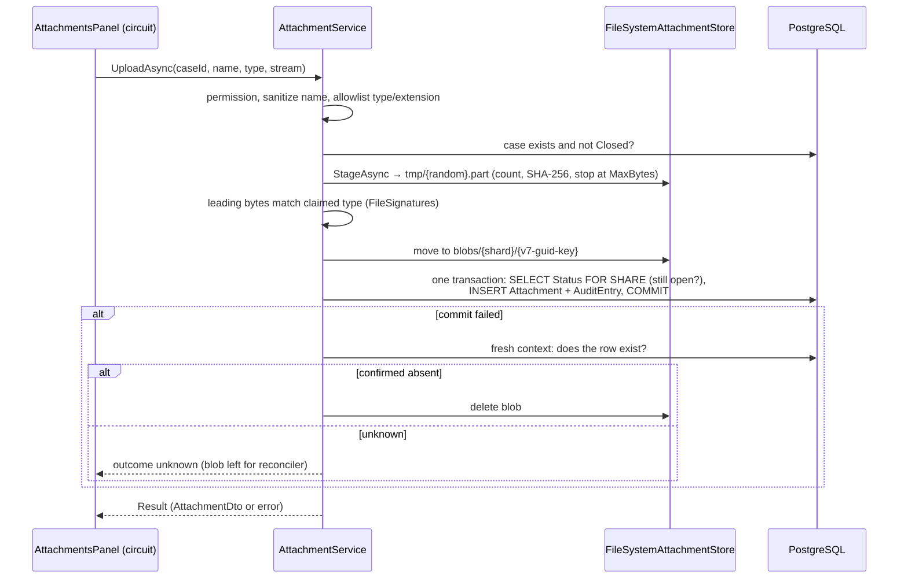
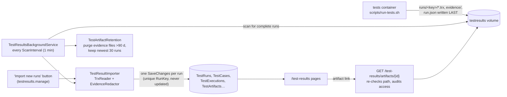
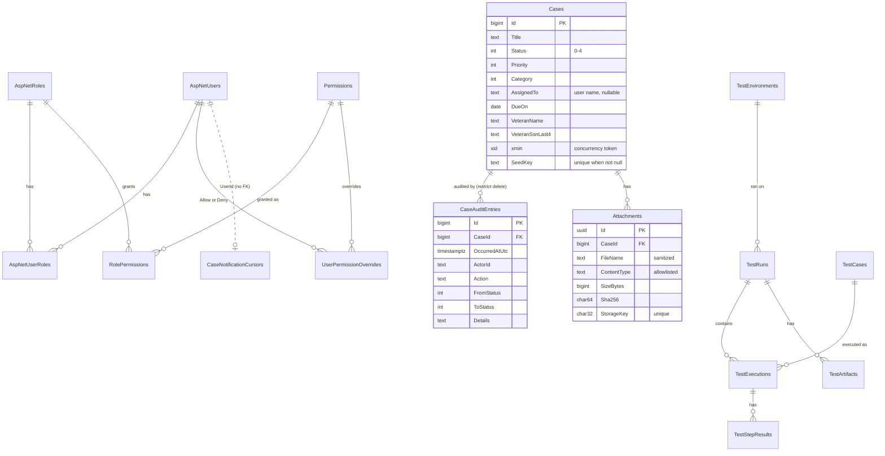

# Architecture

Case Intake and Triage is a modular monolith: one Blazor Web App (.NET 10, Interactive Server) over one PostgreSQL 18
database, plus two satellite processes, a one-shot migrator and a synthetic Veteran Lookup service. This document
explains how the pieces fit together and why. The detailed decisions are in the [ADRs](adr/README.md). Versions are
listed in [versions.md](versions.md).

- [1. Runtime topology](#1-runtime-topology)
- [2. Solution structure and dependency rules](#2-solution-structure-and-dependency-rules)
- [3. Inside the web app](#3-inside-the-web-app)
- [4. Identity, roles and authorization](#4-identity-roles-and-authorization)
- [5. Cases: workflow, assignment, audit](#5-cases-workflow-assignment-audit)
- [6. Attachments](#6-attachments)
- [7. Veteran lookup](#7-veteran-lookup)
- [8. Test results module](#8-test-results-module)
- [9. Data model](#9-data-model)
- [10. Cross-cutting concerns](#10-cross-cutting-concerns)
- [11. Testing architecture](#11-testing-architecture)
- [12. Extending the system](#12-extending-the-system)

---

## 1. Runtime topology

Everything runs from `docker-compose.yml`. Only `web` is published to the host. The other services are reachable only
on the Compose network.

**Startup order** is enforced by Compose `depends_on` conditions:

1. `db` becomes healthy (`pg_isready`).
2. `migrator` applies EF migrations, retrying with backoff while the database starts. It then runs the seed contributors
   in order (Identity roles and demo users first, then 72 synthetic cases), reconciles attachment storage, and exits `0`.
3. `veteran-lookup` becomes healthy (`GET /health`).
4. `web` starts only after the migrator **completed successfully** and the lookup is healthy. Its own health check
   requires both `/health/ready` and `/_framework/blazor.web.js`, so a container whose static assets are missing never
   counts as healthy.

The web app never migrates the schema itself. Schema changes ship only through the migrator, so a running web app
never races a migration.

**Test profile** (`--profile tests`): `migrator-e2e` and `web-e2e` run the same production image against a separate
database (`caseintake_e2e`) and separate volumes. The `tests` container (SDK + Playwright Chromium) runs every suite
and writes the results to the `testresults` volume, and the demo `web` app imports them (see
[§8](#8-test-results-module)). Browser tests therefore never change the demo data.

**Images**: the root multi-stage `Dockerfile` builds two images. `runtime` holds the published web app and migrator on
the ASP.NET runtime image. `eval` holds the compiled Release solution plus Chromium. The `veteran-lookup` image is built
from its own `src/CaseIntake.VeteranLookup.Mock/Dockerfile`, which copies only the projects the mock needs, so base-image
updates must be made in both files. SDK stages run on `$BUILDPLATFORM`, so Apple Silicon compiles natively and emulates
only the running containers. Base images are pinned by digest and NuGet restores in locked mode.

---

## 2. Solution structure and dependency rules

`ArchitectureTests` (in `tests/CaseIntake.IntegrationTests/Architecture`) read every `csproj` and fail the build when
a rule is broken:

| Project | May reference |
|---|---|
| `Domain` | nothing; no EF Core, Identity or Npgsql packages |
| `Contracts` | `Domain` only; no EF Core, Identity or Npgsql |
| `Persistence` | `Domain`, `Contracts` |
| Feature modules (`Cases`, `Identity`, `Attachments`, `TestResults`) | `Persistence`, `Domain`, `Contracts`, and **never another feature module** |
| `VeteranLookup.Client` | `Contracts` only (no database access) |
| `VeteranLookup.Mock` | not `Persistence` or `Domain` |
| any | no cycles |

Consequences of this design:

- **Modules collaborate only through `Contracts`.** For example, `Cases` needs the current user but cannot see
  `Identity`. It depends on `ICurrentUser` from `Contracts`, and `Identity` supplies the implementation.
- **Code that needs two modules lives in the composition root.** The attachment download endpoint needs the Identity
  HTTP actor and the attachment service, so it lives in `CaseIntake.Web/Endpoints`, not in either module.
- **Each module registers itself** with one extension method: `AddCasesModule`, `AddIdentityModule`,
  `AddAttachmentsModule`, `AddTestResultsModule` and `AddVeteranLookupClient`. `Program.cs` calls `AddPersistence`
  first, then those, then `AddWebUi`. The only things it wires up inline are the `attachment-storage` health check and
  Data Protection key storage. The migrator calls `AddPersistence` and then the narrower `AddIdentitySeed`,
  `AddCasesSeed` and `AddAttachmentsMaintenance`.
- **The domain is pure C#.** `Case`, `CaseWorkflow`, `CaseTextRules`, `CaseTriageRules`, `AttachmentFileName` and
  `EasternTime` can be unit-tested with no host or database.

| Path | Responsibility |
|---|---|
| `src/CaseIntake.Domain` | `Case` (private setters, mutation methods), `CaseWorkflow`, `CaseAuditEntry`/`AuditEvent`, triage rules, `Attachment`, test-result entities, `EasternTime` |
| `src/CaseIntake.Contracts` | `ICaseService`, `ICaseAssignmentService`, `ICaseNotificationService`, `IAttachmentService`, `IVeteranLookupClient`, `ITestResultsService`, `IUserAdministrationService`, `ICurrentUser`/`OperationActor`, `RolePermissionMap`, `Result<T>`/`Error`, event ID ranges |
| `src/CaseIntake.Persistence` | `AppDbContext` (Identity + all module tables), entity configurations per module, migrations, `AuditAppender`, `AuditTrailGuard`, `SystemAudit` (system audit log), `PermissionQueries` (stored role permissions and overrides), UTC converters, `DatabaseInitializer`, `SeedRunner` |
| `src/CaseIntake.Cases` | `CaseService` (intake, detail, edit, list, status, assignment, audit trail), `CaseAssigneeDirectory`, `CaseNotificationService`, case seed |
| `src/CaseIntake.Identity` | cookie auth, permission policies, `PermissionResolver`, `ICurrentUser` adapters, revalidation, sign-in/out, password change, user and role administration (`AdministrationRules`), audit log and error log services, System Health, security headers, demo-user and default-permission seed |
| `src/CaseIntake.Attachments` | `AttachmentService`, `FileSystemAttachmentStore`, file signature checks, startup reconciler |
| `src/CaseIntake.VeteranLookup.Client` | typed `HttpClient` with a Polly retry/timeout pipeline |
| `src/CaseIntake.VeteranLookup.Mock` | standalone minimal API that serves the Government contract verbatim |
| `src/CaseIntake.TestResults` | TRX/evidence importer, redaction, retention, background scan, CSV/HTML reports |
| `src/CaseIntake.ServiceDefaults` | redacting JSON console logger, operation-ID middleware, health checks and endpoints |
| `src/CaseIntake.Web` | Razor components (`Layout`, `Kit`, `Pages`, `Account`), minimal API endpoints, dashboard/UI services |
| `src/CaseIntake.MigrationService` | migrate → seed → reconcile, then exit |

---

## 3. Inside the web app

### Render modes

App pages run **Interactive Server**: UI events travel over a SignalR WebSocket (`/_blazor`) to a per-user *circuit*
on the server. The account pages (`/account/login`, `/account/change-password`, `/account/access-denied`,
`/welcome`, `/error`) are marked `[ExcludeFromInteractiveRouting]` and stay **static SSR**. Sign-in and sign-out
must be ordinary HTTP form posts that can set and clear the auth cookie, which a circuit cannot do
([ADR 0010](adr/0010-render-mode.md)). `App.razor` picks the mode per request with
`HttpContext.AcceptsInteractiveRouting()`.

### Two ways into the services

Every business operation goes through a `Contracts` interface, whichever way the request arrives. What differs is
how the service learns **who is asking**:

- **Circuit path.** Pages inject `ICaseService` and similar services, which are scoped to the circuit. The unkeyed
  `ICurrentUser` is `CircuitCurrentUser`. It reads the circuit's authentication state *on every call*, so a
  revalidation that signs the user out takes effect on the next operation. It never touches `HttpContext`, which is
  stale or absent inside a circuit.
- **HTTP path.** Downloads and exports are minimal API endpoints because the browser must fetch a file. They resolve
  `HttpCurrentUser` by key and build a service instance bound to it through `IAttachmentServiceFactory`,
  `ITestResultsServiceFactory` or `ActivatorUtilities`.

| Endpoint | Policy | Notes |
|---|---|---|
| `GET /cases/{caseId}/attachments/{id}/content` | `attachments.download` | 401/403/404 without a login redirect; `no-store`; always `Content-Disposition: attachment` |
| `GET /exports/cases.csv` | `cases.view` | same filters as the list page; at most 10,000 rows; formula-injection-safe cells |
| `GET /test-results/artifacts/{id}` | `testresults.view` | evidence served only through this endpoint, never as static files; access is audited |
| `GET /test-results/runs/{runId}/export/{format}` | `testresults.view` | CSV or self-contained HTML report |
| `POST /account/logout` | anonymous + antiforgery | |
| `/health`, `/health/live`, `/health/ready` | anonymous | JSON; 503 if any check is Unhealthy |

### DbContext lifetime

A circuit can live for hours, but an EF `DbContext` must not. Services therefore receive
`IDbContextFactory<AppDbContext>` and use `await using var db = await factory.CreateDbContextAsync()` **once per
operation** ([ADR 0002](adr/0002-data-access-and-database.md)). Npgsql retry-on-failure is on, so any explicit
transaction must run inside `CreateExecutionStrategy().ExecuteAsync(...)`. The Identity EF stores are the one
exception. They use the request-scoped context, and only static SSR account requests or fresh DI scopes resolve them
(`UserAdministrationService` and the revalidator create a scope per call).

### Service conventions

Every module service follows the same steps, so they read alike:

1. `var actor = await currentUser.GetAsync(ct)`: read the actor once.
2. Check the permission and return `Result.Failure(Forbidden)` if it is missing. The shared `AuthorizationDenied`
   event (3005) is logged.
3. Validate the input (shared validators in `Contracts`/`Domain`).
4. Open a context, load, call a domain method, append the audit entry, `SaveChangesAsync` **once**.
5. Return `Result<T>` with a materialized DTO. Entities never leave the service.

Expected failures are `Result<T>` values with an `ErrorKind` (`Validation`, `NotFound`, `Forbidden`, `Conflict`,
`InvalidTransition`, `ExternalUnavailable`), not exceptions. Domain methods still throw `CaseRuleException` as the
last line of defence.

### UI composition

- `Components/Layout`: `MainLayout`, responsive shell (`SideNav` ≥1024 px, `MobileAppBar` + `BottomNav` + sheets
  below), `NotificationBadge`, `TopProgressBar`, `ReconnectModal`.
- `Components/Kit`: the accessible component kit (labelled inputs, `FormErrorSummary`, `ModalDialog`, `PagerControl`,
  `StatusPill`, `PriorityBadge`, `KpiTile`, SVG `Chart`, `FocusOnNavigation`, `StatusAnnouncerOutlet`).
- `Components/Pages`: Home (dashboard), Cases (list, new, detail with workflow stepper, triage, attachments, audit
  trail), My work, Notifications, Reports, Admin (Users, Roles, Audit log, Errors, System health), TestResults/*.
- Circuit-scoped UI services: `ShellState` (title, breadcrumbs, back target, focus memory), `StatusAnnouncer` (polite
  live region), `PageActivity` (progress bar), `UiInterop` (JS module), `CaseDashboardService`.
- `CaseActivitySignal` is a **process-wide singleton** event that carries no data. When a page changes a case it
  raises the signal, and every open circuit re-reads its own unread count through the authorized notification
  service. The badge also polls every minute.

Pages declare their policy with `[Authorize(Policy = Permissions.X)]`. Anonymous users are sent to sign-in with a
return URL, except that an anonymous request for the site root (`/`) goes to the `/welcome` landing page (the cookie
handler's `OnRedirectToLogin` in `IdentityModule`). `Routes.razor` shows signed-in users without the permission an access-denied message instead of redirecting them. UI
gating is a convenience only, because every service re-checks permissions.

---

## 4. Identity, roles and authorization

Authentication is local ASP.NET Core Identity with cookie authentication (`CaseIntake.Auth`, HttpOnly, SameSite=Lax,
8 h sliding), lockout after 5 failures for 5 minutes, and no self-registration
([ADR 0007](adr/0007-roles-and-permissions.md)). Data Protection keys persist on the `dataprotection` volume, so
cookies survive container recreation.

**Permissions, not roles, are checked.** Since Change 1 ([ADR 0013](adr/0013-database-roles-and-permissions.md)) the
database is the source of truth for who holds what: role permissions and per-user Allow/Deny overrides are stored in
PostgreSQL and changed on the Roles and Users pages. A user's effective permissions are the union over their roles,
plus Allow overrides, minus Deny overrides (Deny always wins; an inactive user holds nothing), resolved by
`PermissionResolver` and built into the actor snapshot by `OperationActorFactory`. `RolePermissionMap` in `Contracts`
defines the permission names and the **defaults** the seed writes into each built-in role once; administrators' later
changes are never overwritten. One authorization policy is registered for each entry in
`RolePermissionMap.AllPermissions`, with the policy name equal to the permission name, and the fallback policy requires
an authenticated user. `PermissionCatalog` describes every permission for the UI, and a test keeps it equal to
`AllPermissions`.

Default grants (seeded; administrators can change all but Administrator's):

| Permission | Auditor | IntakeClerk | CaseWorker | Supervisor | QualityAnalyst | Administrator |
|---|:-:|:-:|:-:|:-:|:-:|:-:|
| `cases.view` | ✓ | ✓ | ✓ | ✓ | ✓ | ✓ |
| `attachments.download` | ✓ | ✓ | ✓ | ✓ | | ✓ |
| `cases.create`, `veteran.lookup`, `attachments.upload` | | ✓ | ✓ | ✓ | | ✓ |
| `cases.edit` | | | ✓ | ✓ | | ✓ |
| `cases.transition.Triaged.InProgress`, `…InProgress.Resolved` | | | ✓ | ✓ | | ✓ |
| `cases.transition.New.Triaged`, `…Resolved.Closed`, `…Resolved.InProgress` | | | | ✓ | | ✓ |
| `cases.assign`, `users.manage` | | | | ✓ | | ✓ |
| `audit.view` | ✓ | | | ✓ | | ✓ |
| `testresults.view`, `testresults.manage` | | | | | ✓ | ✓ |
| `roles.manage`, `errors.view`, `errors.manage`, `system.health` | | | | | | ✓ |

The four case roles nest (Auditor ⊂ IntakeClerk ⊂ CaseWorker ⊂ Supervisor). QualityAnalyst is separate, and
Administrator always holds every permission. Administration never escalates: nobody grants, removes or overrides a
permission they do not hold, manages a user who holds one, or changes their own account (`AdministrationRules`).

The same `OperationActor` snapshot backs three enforcement points, so they cannot disagree:

1. **Pages and endpoints**: `PermissionAuthorizationHandler` evaluates the policy.
2. **Services**: `actor.HasPermission(...)` at the top of each operation.
3. **UI affordances**: for example `CaseDetailDto.AllowedNextStatuses` and `CaseAssignmentRules.RightFor` decide which
   buttons appear.

**Session revalidation.** `IdentityRevalidatingAuthenticationStateProvider` re-checks each open circuit against the
database every `Identity:RevalidationInterval` (1 minute). A deleted or deactivated user, or a changed security stamp
(password or role change), replaces the circuit's principal with an anonymous user. Permission and override changes
need no new sign-in: they apply at the next permission check. Cookie-authenticated HTTP requests use the same
interval through `SecurityStampValidatorOptions`.

**Security headers** (`SecurityHeadersMiddleware`, on every response): a CSP with `script-src 'self'` and no inline
scripts (so there is no `<ImportMap />` and JS modules load by fingerprinted URL), `connect-src` limited to the same
host's ws/wss origin, `frame-ancestors 'none'`, `nosniff`, `Referrer-Policy: same-origin`, `X-Frame-Options: DENY`,
and COOP only on trustworthy origins. HSTS is omitted because the spec serves plain HTTP on localhost.

---

## 5. Cases: workflow, assignment, audit

### Status workflow

The allowed edges live in one table in `CaseWorkflow` (Domain, [ADR 0005](adr/0005-case-workflow.md)). Each edge is
also its own permission, so who may take an edge is configured independently of whether the edge exists.

`ChangeStatusAsync` checks the steps in order: the edge exists (`InvalidTransition` otherwise), the actor holds
`cases.transition.{from}.{to}` (`Forbidden` otherwise), and the version matches (`Conflict` otherwise). Only then does
it call `Case.TransitionTo`. Reopen is audited as `Reopened`, and every other edge as `StatusChanged`. A Closed case
cannot be edited or reassigned.

### Triage and assignment

Each case has `Priority` (Low … Urgent), `Category`, `AssignedTo` (a user name, or null) and `DueOn` (a calendar
date). If intake leaves the due date empty, it defaults to the Eastern calendar day of creation plus 2, 5, 10 or 30
days by priority. *Overdue* means open (New, Triaged or InProgress) with `DueOn` before today in Eastern time. The
case list filter, the dashboard and the badges all use this one definition.

After intake, the owner changes **only** through `ICaseAssignmentService.AssignAsync`, which records an `Assigned`
audit entry. `Case.Edit` ignores the owner field. At intake, `CreateAsync` can also set the first owner from the triage
block, but only if the actor holds `cases.assign` and the user is assignable. That initial owner appears only in the
`Created` audit entry, with no separate `Assigned` entry. The rules for `AssignAsync` are in `CaseAssignmentRules`
(Contracts) and are shared by the service and the UI:

| Actor | Allowed |
|---|---|
| has `cases.assign` (Supervisor) | assign anyone who can own cases, or unassign |
| has `cases.edit` only (CaseWorker) | **take** an unassigned case for themselves, or **hand back** their own |
| anyone else, or any Closed case | nothing |

Assignable users are active users who hold `cases.edit` through their roles or an override. `CaseAssigneeDirectory`
reads that list from the stored permissions (`PermissionQueries`), so it is never hard-coded.

### Optimistic concurrency

`Case.Version` maps to PostgreSQL's `xmin` system column. Every mutating request carries the version the user last
saw. The service compares it up front, then sets it as the concurrency token's *original value* before saving. A
stale browser form and a concurrent commit therefore both surface as `Conflict`, and the UI asks the user to reload.

### Audit trail and notifications

([ADR 0006](adr/0006-audit-trail.md)) Case rows carry `CreatedBy/At` and `UpdatedBy/At`, and every mutation also
appends one `CaseAuditEntry` (`Created`, `Edited` with changed field names, `StatusChanged`, `Reopened`, `Assigned`,
`AttachmentUploaded`). The audit entry is added to **the same context** as the business change, so both commit
together or not at all. `AuditTrailGuard` runs inside every `SaveChanges` overload and throws if an audit row is
modified or deleted. The EF mapping also marks every audit column `Throw` after save. Audit details never contain an
SSN, veteran details, description text or a file name.

Notifications need no extra writes. The feed **is** the audit trail, filtered to entries by other users in the
window. A per-user `CaseNotificationCursor` (a forward-only `LastReadAtUtc`) separates read from unread entries.

---

## 6. Attachments

Bytes go on the filesystem (`attachments` volume) and metadata goes in PostgreSQL
([ADR 0009](adr/0009-attachment-storage.md)). A database and a filesystem cannot share a transaction, so the upload
is ordered to make every failure recoverable:

- Storage keys are server-generated version-7 GUIDs, validated as 32 hex digits before any path is built, so user
  input never reaches a path. The display name is sanitized: path segments, control and format characters (such as
  RTL overrides) and unpaired surrogates are removed, and the name is capped at 200 scalar values.
- The served content type is the **allowlisted** one, never the type the browser claimed. The defaults are PDF, PNG,
  JPEG, TXT and DOCX, up to 10 MB, configurable under `Attachments:*` and validated at startup.
- `AttachmentStorageReconciler` runs in the migrator before `web` accepts uploads. It deletes temporary files and blobs
  that have no metadata row once they are older than a grace period, and counts metadata rows whose blob is missing.
  It never deletes committed content.
- Attachment metadata is write-once. The EF mapping rejects updates.
- The `attachment-storage` readiness check verifies that the root is usable.

---

## 7. Veteran lookup

The Government's OpenAPI definition (spec 4.6) is committed verbatim in
[contracts/veteran-lookup.spec.openapi.yaml](contracts/veteran-lookup.spec.openapi.yaml)
([ADR 0008](adr/0008-veteran-lookup-mock-and-client.md)).

- **Mock** (`CaseIntake.VeteranLookup.Mock`): a minimal API with `POST /veterans/lookup`, `GET /health`, and
  `GET /openapi/v1.yaml`, which serves the Government file byte for byte from an embedded resource. It answers from 50
  synthetic records (SSN area 900–999, never issued). An implementation document generated from the endpoint
  declarations (`/openapi/implementation.json`) is used only as evidence: `OpenApiConformanceTests` diff it against
  the Government file, allowing only the documented 400/415 extensions.
- **Client** (`VeteranLookupClient`): checks `veteran.lookup` and the SSN format (`NNN-NN-NNNN` or nine digits)
  **before** any network call. The resilience pipeline makes at most one retry on connection errors, timeouts, 408,
  429 or 5xx, with a 2 s timeout per attempt. The client owns a 5 s total budget that also covers reading the body.
  Every result maps to `VeteranLookupOutcome` (`Found`, `NotFound`, `InvalidInput`, `Unavailable`, `Forbidden`), so a
  lookup outage never blocks intake. A 200 response is accepted only if name and address pass the same validation the
  case snapshot uses.
- **Data minimization**: a case stores the veteran's name, address and **last four** SSN digits only. The full SSN
  exists only in the request in flight.

---

## 8. Test results module

The application imports its own test evidence, so QA can browse runs, history, flaky tests and screenshots inside the
app ([ADR 0012](adr/0012-test-results-module.md)).

- `run.json` is written last, so the importer treats a folder as complete only when it exists.
- A suite that failed to start or discovered no tests is recorded as **NotExecuted**, so a broken run never looks
  like a passing one.
- The TRX reader prohibits DTDs and bounds the document size. Evidence paths are checked to stay inside their run
  folder (`SafeChild`).
- All stored text (failure messages, stack traces, console and network logs, server logs) passes through
  `EvidenceRedactor`, which masks SSNs, passwords, bearer tokens, cookies, antiforgery tokens, connection-string
  secrets and the configured demo password. Screenshots cannot be redacted afterwards, so the E2E harness masks
  sensitive inputs before capturing them.
- Retention deletes evidence **files** only. Runs, executions and steps stay forever, so trends remain complete.

---

## 9. Data model

One database and one `AppDbContext` (derived from `IdentityDbContext<AppUser, AppRole, string>`). Each module owns
its entity configurations under `Persistence/Configurations/<Module>/`. Migrations are named
`<Epic>_<Change>`: `E1_Baseline`, `E2_Cases`, `E4_Attachments`, `E5_TestResults`, `E5_CaseTriageAndNotifications`,
and for Change 1 `C1_DatabasePermissions`, `C2_AuditLog`, `C3_ErrorLog`. The Change 1 tables (`Permissions`,
`RolePermissions`, `UserPermissionOverrides`, `AuditLogEntries`, `ErrorLogEntries`) are described in
[ADR 0013](adr/0013-database-roles-and-permissions.md), [ADR 0014](adr/0014-system-audit-log.md) and
[ADR 0015](adr/0015-error-log-and-system-health.md).

Conventions:

- **All instants are UTC `timestamptz`.** Converters are applied by convention to every `DateTime`/`DateTimeOffset`.
  `BannedSymbols.txt` forbids `DateTime.Now`, `UtcNow` and the like. Code takes the time from an injected
  `TimeProvider`, which tests can control.
- **Business days are US Eastern** (`EasternTime`): due dates, "today", overdue, and month buckets in the dashboard.
- **Enums are stored as integers** that are never renumbered. Check constraints bound the status columns.
- **Seeding** goes through `ISeedContributor` (static `Order`). `SeedRunner` runs each contributor in its own scope.
  Seeds are idempotent: demo users are matched by email, and their password is applied only when the account is first
  created. Cases are matched by `SeedKey`.

---

## 10. Cross-cutting concerns

**Logging** ([ADR 0003](adr/0003-telemetry-and-logging.md)). `AddServiceDefaults` replaces all providers with
`RedactingJsonConsoleFormatter`, which writes one JSON object per line to stdout. Each line carries a UTC timestamp,
level, category, EventId/EventName, message, structured state, and scopes (`OperationId`, TraceId/SpanId). Exception
**messages are never written**, only the type, because provider messages can embed submitted values. Every string
then passes through `SsnRedaction` as a last resort. The primary control is that log calls use only safe fields
through source-generated `[LoggerMessage]` methods (`CaseLog`, `IdentityLog`, `LookupLog`, …). EventIds are reserved
per epic: 1xxx E1, 2xxx E2, and so on. No telemetry exporter is configured, so nothing leaves the host.

**Operation IDs.** `OperationContextMiddleware` opens a logging scope with a fresh operation ID for each request and
returns it as `X-Operation-Id`. The migrator wraps its run in `BeginOperation("migrate-and-seed")`.

**Health.** `/health/live` runs no checks, so the app is never restarted because a dependency is down.
`/health/ready` runs `database` (`SELECT 1`), `veteran-lookup` (`GET {base}/health`) and `attachment-storage`.
Each check times out after 5 s. Responses are JSON, never contain exception messages, and return 503 if any check is
Unhealthy.

**Configuration.** `appsettings.json` provides the defaults, overridden by environment variables using `__`. The
attachment, veteran lookup and test results options use `ValidateOnStart`, so a bad value stops startup instead of
failing the first request. `IdentityModuleOptions` (`Identity:RevalidationInterval`) and `CaseNotificationOptions` are
bound without validation, so a bad value there shows up only at runtime. A missing
connection string throws at startup. The web app fails fast (`WebRootGuard`) if it is started outside its publish
folder, where it could not serve `blazor.web.js`. The full settings table is in the [README](../README.md).

**Build hygiene.** `Directory.Build.props` sets `TreatWarningsAsErrors`, nullable reference types, the latest
analyzers, the banned-API analyzer, and lock-file restores. `Directory.Packages.props` pins every package centrally.

---

## 11. Testing architecture

([ADR 0004](adr/0004-test-strategy.md), [testing.md](testing.md))

Every suite uses NUnit 4.4 and the browser suite Playwright 1.52 ([ADR 0016](adr/0016-nunit-and-playwright-pins.md));
`tests/CaseIntake.Testing` holds the shared NUnit support (class fixtures, `IAsyncLifetime`, `TheoryData`, `Assert`).

| Suite | Scope | Hosts |
|---|---|---|
| `Cases.Tests`, `Identity.Tests`, `Attachments.Tests`, `VeteranLookup.Tests` | domain rules, the permission matrix, sanitizing, client retries, contract conformance | none, or an in-process mock |
| `Web.Tests` | bUnit component tests: layout landmarks, form kit, pages per role, dashboard | bUnit with fakes from `TestKit` |
| `IntegrationTests` | architecture rules, migrations, seeding, services against real PostgreSQL, authorization, logging, health, static assets, exports | `CaseIntakeWebFactory` (WebApplicationFactory) + Testcontainers PostgreSQL, or `TESTKIT_POSTGRES_ADMIN` |
| `E2E` | Playwright + axe: keyboard, roles, viewports, framework JS | the Docker-hosted `web-e2e` |

`CaseIntake.TestKit` provides `PostgresDatabaseFixture` (a database per fixture), `CaseIntakeWebFactory`, and fakes
for every contract (`FakeCurrentUser`, `InMemoryCaseService`, `InMemoryAttachmentService`,
`FakeVeteranLookupClient`). Because modules depend only on `Contracts`, a fake can replace any module without the
others noticing.

`scripts/run-tests.sh` runs the pre-built Release suites and writes one TRX per suite plus `run.json`. The app then
imports these results itself ([§8](#8-test-results-module)), which closes the loop.

---

## 12. Extending the system

| To add… | Do this |
|---|---|
| a new feature module | new `src/CaseIntake.X` referencing only `Persistence`/`Domain`/`Contracts`; public interface in `Contracts/X`; an `AddXModule(configuration)` extension; a call in `Program.cs`; add the name to `FeatureModules` in `ProjectGraph.cs` |
| a table | entity in `Domain`, configuration in `Persistence/Configurations/X`, `DbSet` in `AppDbContext`, then `dotnet ef migrations add <Epic>_<Change> -p src/CaseIntake.Persistence -s src/CaseIntake.Persistence -o Migrations` |
| a permission | constant in `Permissions`; add it to `RolePermissionMap.AllPermissions` (this is what registers the policy) and describe it in `PermissionCatalog`; set its default roles in `RolePermissionMap` (the seed grants new defaults to existing databases once; administrators can change them afterwards on the Roles page); update the matrix and counts in `RolePermissionMapTests`; `[Authorize(Policy = …)]` on the page **and** a check in the service |
| a workflow edge | add it to `CaseWorkflow.Edges` and `RolePermissionMap.TransitionPermissions` (which gives it to Supervisor and registers its policy); if case workers may take it, also add it to the `Casework` grants; update `RolePermissionMapTests`. The UI buttons, dashboard "pending tasks" and audit then follow automatically |
| an audited case action | a constant in `AuditActions` (never rename existing ones), a factory on `AuditEvent`, and `AuditAppender.Append` in the same context as the change |
| seed data | an `ISeedContributor` with an `Order`, registered in the migrator with `AddSeedContributor<T>()`; it must be idempotent |
| an HTTP download/export | an endpoint in `CaseIntake.Web/Endpoints`, `RequireAuthorization(permission)`, `DisableCookieRedirect()`, and the keyed HTTP `ICurrentUser` passed to a service factory |

Before a shared deployment, the items in the README's *Before a shared or production deployment* section must be
addressed (HTTPS, a real IdP, secrets, the real lookup service, backups, malware scanning). See also
[assumptions-and-limitations.md](assumptions-and-limitations.md).
